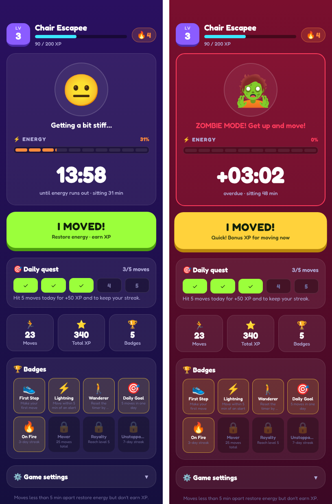

# Move Reminder (POC)

A small React Native (Expo) Android app that **tells you out loud** when you've been
sitting too long and need to get up and move.



## What it does

### The game
- **Energy bar.** Your energy drains while you sit. When it hits 0% you go into
  🧟 **Zombie mode**: the screen turns red and the app shouts at you until you move.
- **XP and levels.** Every move earns XP. Bonus XP for moving within 5 minutes of an alert
  (+15), moving before the alert (+5) or moving by walking (+5). Levels go from
  *Couch Potato* up to *Legend of Motion*. Moves less than 5 minutes apart restore energy but
  don't earn XP, so you can't farm XP by tapping the button.
- **Daily quest and streak.** Make 5 moves a day for +50 XP and to keep your 🔥 streak alive.
- **Badges.** 8 unlockable badges (First Step, Lightning, Wanderer, On Fire…).
- Level-ups, badges and XP gains get a pop-up and a spoken announcement.

### The reminder
- **Loud spoken alert.** When energy runs out and the app is open, it speaks the reminder at
  full volume using text-to-speech, vibrates hard and repeats every minute until you move.
- **Background alerts that don't give up.** A reminder plus follow-up nags (+2, +5, +10, +15,
  +20 min, then every 10 min for 3 hours) are scheduled as local notifications. They fire even
  if the app is in the background or closed. In the installable APK they play on the Android
  **alarm** audio stream, so they're loud even when media volume is low.
- **Buttons on the notification.** **✅ I moved!** records the move, gives XP and restarts the
  timer without opening the app. **⏰ Snooze 5 min** pauses the alerts briefly (no XP). In the
  APK these work even when the app is closed. Expo Go can't run them in the background.
- **Auto-reset on walking.** With the step counter enabled, about 30 steps counts as a move.
- Settings, timer and game progress are saved on the device.

## Run it

Requires Node 20+ and an Android phone, or an emulator.

```bash
npm install
npx expo start        # then press "a", or scan the QR code with Expo Go
```

**Expo Go** is enough to try the timer, the spoken alert and local notifications. To get
everything (custom notification channel, step counter permissions, exact alarms), make a
development build:

```bash
npx expo run:android                                 # local build (needs the Android SDK)
# or a cloud build of an installable APK:
npx eas-cli@latest build -p android --profile preview
```

To test quickly, open **Game settings**, pick **1 min 🧪**, tap **START PLAYING** and wait.
Or tap **Test the loud alert** in Game settings.

## Project layout

| File | Purpose |
| --- | --- |
| `App.tsx` | Main screen, timer loop, foreground alert, step detection |
| `src/moveService.ts` | Records a move or snooze; shared by the app and the notification buttons |
| `src/backgroundTask.ts` | Handles notification buttons while the app is closed (Android) |
| `src/game.ts` | XP, levels, streaks, badges (saved with AsyncStorage) |
| `src/ui.tsx` | Game-style UI pieces: 3D buttons, energy bar, avatar, reward pop-up |
| `src/reminder.ts` | Notification channel, scheduling, text-to-speech and vibration |
| `src/storage.ts` | Saved settings (AsyncStorage) |
| `app.json` | Expo config: Android package and permissions |
| `eas.json` | EAS build profiles (`preview` builds an APK) |

## Known POC limitations / next steps

- **Speech only plays while the app is open.** In the background you get the loud
  notification sound and vibration, not the spoken sentence. Making it speak in the
  background would need a native foreground service (e.g. Notifee or a custom module)
  that runs text-to-speech when the alarm fires.
- **Steps are only counted while the app is open.** Background step tracking would need
  `getStepCountAsync` polling (iOS) or a foreground service (Android).
- Some Android phone makers (Xiaomi, Samsung, Oppo…) delay or kill scheduled alarms to save
  battery. Excluding the app from battery optimization helps.
- Android locks a notification channel's settings once it's created. If you change the
  channel in `src/reminder.ts`, uninstall and reinstall the app.
## Getting the APK

Every push runs the **Build Android APK** GitHub Actions workflow. Open the run on the
**Actions** tab and download the `move-reminder-apk` artifact.

## Ideas

- Possible ideas: quiet hours / working hours only, custom alarm sound, your own voice
  recordings, daily stats, a home-screen widget.
