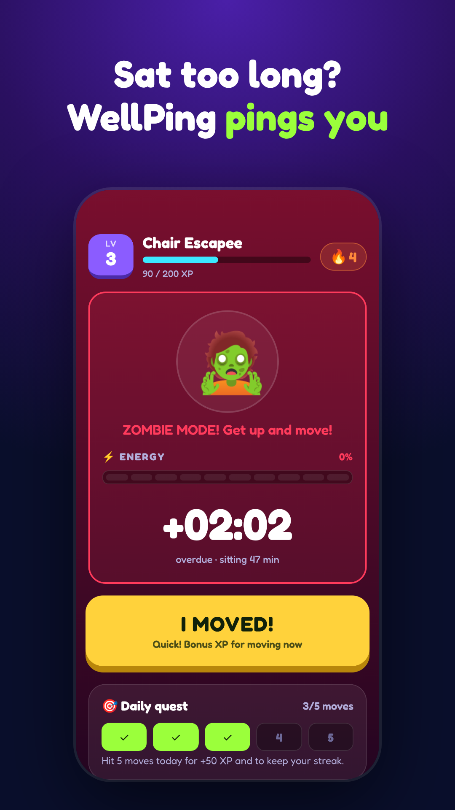

# WellPing

A React Native (Expo) app for **iOS and Android** that **tells you out loud** when
you've been sitting too long and need to get up and move.



## What it does

### The game
- **Energy bar.** Your energy drains while you sit. When it hits 0% you go into
  🧟 **Zombie mode**: the screen turns red and the app shouts at you until you move.
- **Pip, your buddy.** A little character that gets stiff and turns into a zombie while you sit,
  naps outside work hours, and **evolves** as you level up: Pip Sprout → Pip (Lv 3) →
  Pip Pro (Lv 5) → Pip Legend (Lv 7). Unlock hats (cap, sweatband, party hat, beanie, crown).
- **Challenge cards.** Each alert deals a random card, like "10 squats" or "Take the stairs".
  🟢 Common 60%, 🔵 Rare 25% (+10 XP), 🟣 Epic 12% (+20 XP), 🟡 Legendary 3% (+40 XP).
  Completed cards go into your collection (25 to find).
- **Voice personalities.** Coach Pip, Drill Sergeant (Lv 2), Grandma (Lv 3), Sarcastic Robot
  (Lv 4), Captain Pip (Lv 5) and Zen Master (Lv 6), each with their own lines, pitch and speed.
  Notifications are written in the chosen voice too.
- **XP and levels.** Every move earns XP. Bonus XP for moving within 5 minutes of an alert
  (+15), moving before the alert (+5) or moving by walking (+5). Levels go from
  *Couch Potato* up to *Legend of Motion*. Moves less than 5 minutes apart restore energy but
  don't earn XP, so you can't farm XP by tapping the button.
- **Daily quest and streak.** Make 5 moves a day for +50 XP and to keep your 🔥 streak alive.
- **Badges.** 10 unlockable badges (First Step, Lightning, Collector, Legendary…).
- Level-ups, unlocks, badges and cards get a pop-up and a spoken announcement.
- **Your stats.** Days active, moves per day (14-day chart with the daily goal), how many
  alerts you answered within 5 minutes, average response time, snoozes and longest sit.
  **Share my report** sends a text summary, handy for testers. All stats stay on the phone.

### The reminder
- **Loud spoken alert.** When energy runs out and the app is open, it speaks the reminder at
  full volume using text-to-speech, vibrates hard and repeats every minute until you move.
- **Background alerts that don't give up.** A reminder plus follow-up nags (+2, +5, +10, +15,
  +20 min, then every 10 min for 3 hours) are scheduled as local notifications. They fire even
  if the app is in the background or closed.
- **Buttons on the notification.** **✅ I moved!** records the move, gives XP and restarts the
  timer. **⏰ Snooze 5 min** pauses the alerts briefly (no XP).
- **Work hours.** Optionally remind only on chosen days between a start and end time
  (e.g. Mon–Fri, 09:00–18:00). Outside them Pip naps, and days off don't break your streak.
- **Auto-reset on walking.** With the step counter enabled, about 30 steps counts as a move.
- Settings, timer and game progress are saved on the device. On Android they're also included
  in the phone's automatic Google backup, so a reinstall usually restores them.

## iOS vs Android

The same code runs on both. Where a platform can't do something, the app falls back:

| Feature | Android | iOS |
| --- | --- | --- |
| Reminder sound | Alarm audio stream: loud even with media volume low (APK only, not Expo Go) | Normal notification sound; the silent switch mutes it (louder needs Apple's Critical Alerts approval) |
| Spoken alert (app open) | ✅ | ✅ Plays even with the silent switch on |
| Notification buttons | Work in the background, without opening the app (APK only) | Open the app, which records the tap |
| Walking detection | While the app is open | While the app is open, **plus** steps walked while it was closed (100+ steps since your last move count as a move when you return) |
| Progress survives a reinstall | Usually, via Google's automatic app backup | Only when restoring a whole iPhone backup |

## Run it

Requires Node 20+ and a phone (Android or iPhone), an Android emulator or the iOS Simulator.

```bash
npm install
npx expo start        # press "a" (Android emulator) or "i" (iOS Simulator),
                      # or scan the QR code with Expo Go on a phone
```

**Expo Go** is enough to try the timer, the spoken alert and local notifications. To get
everything (custom notification channel, step counter permissions, exact alarms), make a
development build:

```bash
npx expo run:android                                 # local build (needs the Android SDK)
npx expo run:ios --device                            # local build on your iPhone (Mac + Xcode)
# or cloud builds with EAS:
npx eas-cli@latest build -p android --profile preview   # installable APK
npx eas-cli@latest build -p ios                         # needs an Apple Developer account
```

With a free Apple ID, `run:ios --device` installs on your own iPhone, but the app stops
opening after 7 days. Sharing with others needs an Apple Developer account and TestFlight.

To test quickly, open **Game settings**, pick **1 min 🧪**, tap **START PLAYING** and wait.
Or tap **Test the loud alert** in Game settings.

## Project layout

| File | Purpose |
| --- | --- |
| `App.tsx` | Main screen, timer loop, foreground alert, step detection |
| `src/moveService.ts` | Records a move or snooze; shared by the app and the notification buttons |
| `src/backgroundTask.ts` | Handles notification buttons while the app is closed (Android only) |
| `src/game.ts` | XP, levels, streaks, badges, card collection (saved with AsyncStorage) |
| `src/schedule.ts` | Work hours, the sitting timer and which reminders to schedule |
| `src/cards.ts`, `src/cardsUI.tsx` | Challenge cards, rarities and the collection grid |
| `src/voices.ts` | Voice personalities and their lines |
| `src/statsUI.tsx` | Stats screen: 14-day chart, response rate, shareable report |
| `src/buddyData.ts`, `src/buddy.tsx` | Pip's evolution stages, hats and vector drawing |
| `src/ui.tsx` | Game-style UI pieces: 3D buttons, energy bar, avatar, reward pop-up |
| `src/reminder.ts` | Notification channel, scheduling, text-to-speech and vibration |
| `src/storage.ts` | Saved settings (AsyncStorage) |
| `app.json` | Expo config: app IDs and permissions for iOS and Android |
| `eas.json` | EAS build profiles (`preview` builds an APK) |

## Known POC limitations / next steps

- **Speech only plays while the app is open.** In the background you get the loud
  notification sound and vibration, not the spoken sentence. Making it speak in the
  background would need a native foreground service (e.g. Notifee or a custom module)
  that runs text-to-speech when the alarm fires.
- **Live step counting only runs while the app is open.** iOS catches up from step history
  when you return; Android would need a foreground service.
- Some Android phone makers (Xiaomi, Samsung, Oppo…) delay or kill scheduled alarms to save
  battery. Excluding the app from battery optimization helps.
- Android locks a notification channel's settings once it's created. If you change the
  channel in `src/reminder.ts`, uninstall and reinstall the app.

## Builds from GitHub Actions

- **Android APK:** every push runs **Build Android APK**. Open the run on the **Actions** tab
  and download the `wellping-apk` artifact.
- **iOS Simulator app:** run **Build iOS Simulator app** manually from the **Actions** tab
  (it uses macOS build minutes). Download `wellping-ios-simulator`, unzip it, start the
  iOS Simulator (Xcode → Open Developer Tool → Simulator) and drag `WellPing.app` onto it.
  This doesn't install on a real iPhone; that needs Apple signing (see above).

## Publishing to the stores

Everything for the store listings is in [`docs/store-listing.md`](docs/store-listing.md): name,
descriptions, keywords, privacy answers, permission reasons and a submission checklist.

- App ID (both stores): `com.deesha.movereminder`. It can't be changed after the first upload.
- Privacy policy page: [`docs/privacy/index.html`](docs/privacy/index.html). Host it and put
  the link in both stores.
- Screenshots: [`docs/screenshots/play`](docs/screenshots/play) (1080 × 1920) and
  [`docs/screenshots/appstore`](docs/screenshots/appstore) (1290 × 2796).
- iPad isn't supported (`supportsTablet: false`), so no iPad screenshots are needed.

## Ideas

- Possible ideas: quiet hours / working hours only, custom alarm sound, your own voice
  recordings, daily stats, a home-screen widget.
